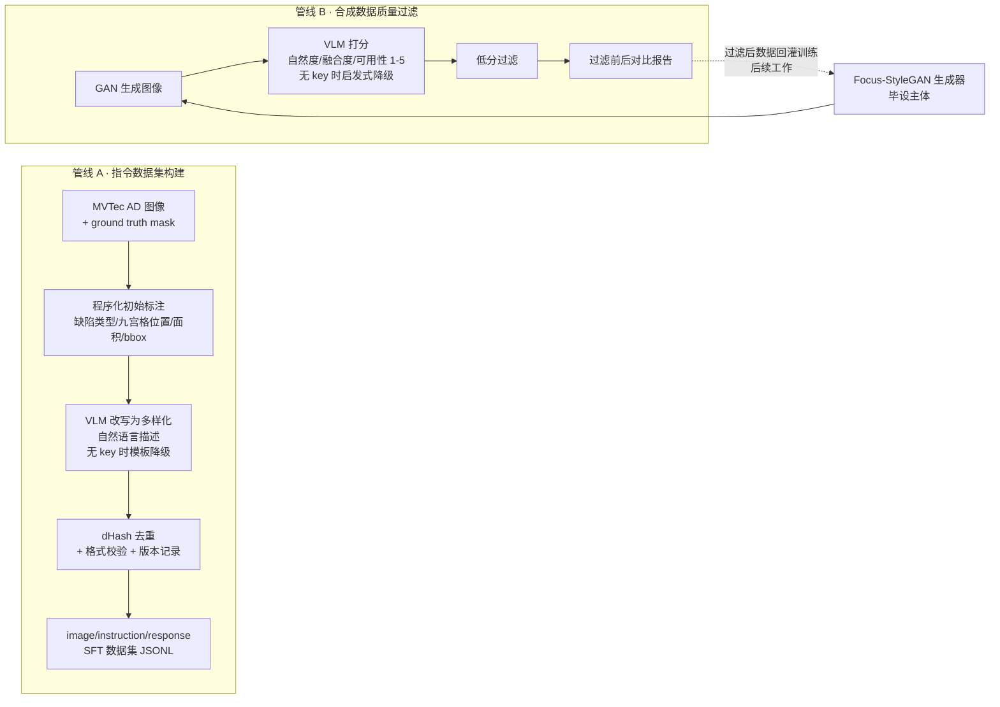

# 多模态数据构建与合成数据质量过滤管线（基于 Focus-StyleGAN 工业缺陷增广毕设演进）

[](https://github.com/MimiQuark/Industrial-Defect-Multimodal-Pipeline/actions/workflows/ci.yml)
[](https://github.com/MimiQuark/Industrial-Defect-Multimodal-Pipeline)

**一句话定位**：把工业缺陷 GAN 生成器的产出，通过「程序化标注 → VLM 改写 → 质量过滤 → 版本化管理」管线，变成可直接对接 LLaMA-Factory 等训练框架的多模态 SFT 训练数据资产。

## 架构



## 最新运行数字（2026-09-02 真实运行，VLM = qwen3-vl-plus；数据基础：synthetic demo，非真实 MVTec AD）

| 指标                     | 数值                                                             | 出处                                                                     |
| ---------------------- | -------------------------------------------------------------- | ---------------------------------------------------------------------- |
| 管线 A 产出 SFT 样本         | **39 条**（42 扫描 → VLM 改写零失败 → dHash 去重 3 → 校验 100% 通过）          | [evaluation/results.md](evaluation/results.md)，`datapipe/versions/v6/` |
| VLM 改写与程序化标注数值一致性      | 抽查吻合（面积占比 1.7%/2.5%/5.2% 对应 mask 标注 0.0170/0.0253/0.0520）      | 同上                                                                     |
| 管线 B · VLM 打分区分度       | 刻意劣化组均分 **1.11** vs 正常候选组 **2.25**（demo 占位图全部被正确判为低质，过滤率 100%） | `datapipe/reports/pipeline_b_report_20260902_225812.md`                |
| 管线 B · 启发式降级（无 key 对照） | 过滤率 **27.8%**（13/18 保留）——与 VLM 的差距即"为什么需要 VLM 打分"的实证           | `datapipe/reports/pipeline_b_report_20260902_203343.md`                |

> 以上数字均来自真实运行（VLM 调用为 DashScope 兼容模式真实 API 请求），  
> 复现命令与边界声明见 [evaluation/results.md](evaluation/results.md)。  
> 仓库不含 MVTec AD 数据集与 checkpoint 权重，演示数据由 `datapipe/make_demo_dataset.py` 程序化合成并明确标注为 synthetic。

## 设计要点

- **交付物是数据管线 + 数据集，而非微调模型**：零样本 VLM 已足够做标注改写和质量打分，微调需要额外算力投入；管线产出的标准 JSONL 可直接对接 LLaMA-Factory 等训练框架。
- **生成器与评估层解耦**：管线 B 只消费「一个图像目录」，把 GAN 换成扩散模型，管线代码一行不用改。
- **为什么用 GAN 不用扩散模型**：小样本工业质检场景下 GAN 推理快、训练成本低，且本项目立项于毕业设计，Focus-StyleGAN 是既有毕设主体；扩散模型可作为后续替换项，管线不变。
- **降级透明**：所有 VLM 调用为 OpenAI 兼容接口（默认 DashScope 兼容模式，`base_url`/`model` 可配置）；无 API key 时自动降级为确定性模板/启发式实现，产出与报告中如实标注，绝不伪装成 VLM 输出。VLM 路径已于 2026-09-02 用 qwen3-vl-plus 真实跑通（管线 A 改写 42 条零失败、管线 B 打分 18 张），降级路径与 VLM 路径的数字在 `evaluation/results.md` 中并存对照。
- **VLM 只做描述与打分**，不承诺像素级定位；标注中的 bbox 来自 ground truth mask 的程序化提取，非 VLM 检测。

## 演进关系

```
Focus-StyleGAN 毕设（生成器）  →  数据管线（datapipe/）：把生成器产出变成可用的训练数据资产
```

---

# 以下为原毕业设计项目说明

## 基于 Focus-StyleGAN 的工业缺陷图像增广系统

毕业设计项目：面向 MVTec AD 工业质检场景的双分支 GAN 缺陷图像增广系统。

## 功能概览

- **Focus-StyleGAN 模型**：缺陷聚焦分支 + 背景保持分支 + 注意力门控融合，多尺度 CBAM 判别器，WGAN-GP 训练
- **四类增广管线**：
  1. GAN 伪异常生成（缺陷类型注册表驱动潜在向量调制）
  2. 真实缺陷迁移（`core/real_defect_blender.py`）
  3. 检索式增广（`core/retrieval_augmentor.py`）
  4. 缺陷堆叠增广（`core/retrieval_augmentor.py`）
- **评估体系**：FID / IS / LPIPS / PSNR / SSIM / PPS（自研物理合理性指标）/ Pixel-AUC / PRO-AUC / 消融实验框架
- **Web 演示**：Flask 交互界面 + RESTful API

## 环境安装

推荐使用自带的环境安装工具——可选 GPU（CUDA 12.1 / 11.8）或 CPU 版 PyTorch，  
逐项检查已装依赖，只安装缺失或版本不符的：

```bash
python setup_env.py
```

也可以手动安装：

```bash
# GPU（CUDA 12.1，其他版本见 pytorch.org）
pip install torch torchvision torchaudio --index-url https://download.pytorch.org/whl/cu121
# 或 CPU
pip install torch torchvision torchaudio --index-url https://download.pytorch.org/whl/cpu

pip install -r requirements.txt
```

预训练权重（VGG16/19、InceptionV3、ResNet）可放入项目根目录 `weights/` 下离线加载，否则首次运行自动下载。

## 目录结构

```
core/                   # 增广管线与公共模块
  integrated_augmentor.py   # 统一增广入口（CLI）
  real_defect_blender.py    # 真实缺陷迁移
  retrieval_augmentor.py    # 检索式 / 堆叠式增广
  defect_registry.py        # 缺陷类型 → pattern → 潜在空间调制注册表
  features.py               # 图像特征提取（公共模块）
  defect_classification.py  # 缺陷类型识别（公共模块）
  blending_utils.py         # 缺陷融合底层操作（公共模块）
  super_resolution.py       # Real-ESRGAN 超分（可选）
  integrated_config.yaml    # 主配置文件
model/
  models/focus_stylegan.py  # 核心模型
  training/trainer.py       # 训练器 + Optuna 超参搜索
  data/loader.py            # MVTec AD 数据集
  augmentation/augmentor.py # GAN 增广器
  evaluation/               # FID/IS/LPIPS/PPS/PRO-AUC/消融
  utils/                    # 配置 / 日志 / 种子 / 权重管理
web/                    # Flask 演示（app.py）与 REST API（web_api.py）
scripts/                # 训练曲线等论文图表生成脚本
tests/                  # 功能测试
datapipe/               # 多模态数据构建与合成数据质量过滤管线（新增）
  annotation.py             # 管线 A：mask → 程序化结构化初始标注
  rewrite.py                # 管线 A：VLM 改写 / 确定性模板降级
  quality.py                # dHash 去重 + JSONL 校验 + 版本记录
  pipeline_a.py             # 管线 A CLI 入口
  pipeline_b.py             # 管线 B：合成数据质量过滤 CLI 入口
  make_demo_dataset.py      # 合成演示数据集生成器（synthetic，非真实 MVTec AD）
  config.yaml               # 路径 / 阈值 / VLM API / 降级开关
  versions/                 # 管线 A 版本化产出（dataset.jsonl + manifest.json）
  reports/                  # 管线 B 过滤对比报告
evaluation/results.md   # 数据管线真实运行数字记录（与 model/evaluation/ 区分）
```

> 以下为运行时目录，不包含在仓库中（见 .gitignore）：  
> `datasets/mvtec_anomaly_detection/`（MVTec AD 数据集）、`checkpoints/`（模型检查点）、`weights/`（预训练权重）

### 数据管线快速开始（datapipe，无需 GPU / 无需 torch）

```bash
# 0. 安装最小依赖（无需 torch；openai 仅 VLM 模式需要）
pip install -r datapipe/requirements.txt

# 1. 生成合成演示数据集（synthetic，仅用于跑通管线；真实使用时替换为 MVTec AD）
python -m datapipe.make_demo_dataset

# 2. 管线 A：图像+mask → SFT 数据集 JSONL（无 API key 自动模板降级）
python -m datapipe.pipeline_a            # 产出 datapipe/versions/v<N>/dataset.jsonl

# 3. 管线 B：合成图像质量过滤（无 API key 自动启发式降级）
python -m datapipe.pipeline_b            # 产出 datapipe/reports/pipeline_b_report_*.md

# 4. 测试
python tests/test_datapipe.py

# 启用 VLM（Qwen-VL，OpenAI 兼容接口）：先安装 openai 并设置环境变量
#   pip install -r datapipe/requirements.txt
#   set DASHSCOPE_API_KEY=sk-...   # Windows
#   export DASHSCOPE_API_KEY=sk-...  # Linux/macOS
# 单条 VLM 失败会自动回退模板，manifest 的 rewrite_mode 记为
# vlm_partial_fallback，并给出 rewrite_mode_counts 明细。
```

## 快速开始（原毕设功能）

### 训练

本地有 GPU 时可直接训练；**没有本地 GPU 时用云端训练方案**（`cloud/` 目录。  
主用 **Kaggle 免费 GPU**：`cloud/kaggle_train.ipynb` 训练 notebook，  
loss/FID 曲线与生成样例全部 inline 输出；额度不够或需长训时用 AutoDL  
类付费平台，配 `check_env.py` + `train_cloud.py` 脚本，详见  
[cloud/README.md](cloud/README.md)）：

```bash
python cloud/check_env.py                                # 环境自检
python cloud/train_cloud.py --category bottle --epochs 30  # 单品类试水
```

本地训练：

```python
import torch, logging
from model.training.trainer import create_trainer_from_config

logger = logging.getLogger("train")
device = torch.device("cuda" if torch.cuda.is_available() else "cpu")
trainer = create_trainer_from_config("core/integrated_config.yaml", device, logger)
trainer.train()
```

默认 GPU 配置：batch_size=32、混合精度（AMP）、cuDNN benchmark 自动开启；  
训练过程中每隔 `training.fid_interval` 个 epoch 自动计算真实 FID 并保存最佳模型。

### 增广（CLI）

```bash
# GAN 伪异常
python core/integrated_augmentor.py --mode single --input path/to/good.png --variations 5

# 真实缺陷迁移（推荐，不依赖 GAN）
python core/integrated_augmentor.py --mode real --input path/to/good.png --category bottle

# 检索式 / 堆叠式
python core/integrated_augmentor.py --mode retrieval --input path/to/good.png --category bottle
python core/integrated_augmentor.py --mode stacking  --input path/to/good.png --category bottle
```

### Web 演示

```bash
pip install -r web/requirements-web.txt   # Web 依赖（Flask 等）

python web/app.py        # 交互界面
python web/web_api.py    # RESTful API
```

### 测试

```bash
python tests/test_basic.py
```

## 配置说明

主要配置见 `core/integrated_config.yaml`：

- `data.dataset_path`：MVTec AD 数据集根目录（默认 `./datasets/mvtec_anomaly_detection`）
- `training.seed`：全局随机种子（默认 42，保证可复现）
- `training.use_amp`：CUDA 下启用混合精度训练
- `training.fid_interval` / `fid_n_samples`：训练中 FID 评估频率与样本数
- `model.*`：生成器/判别器结构参数

## 注意事项

- 2026-08 代码优化后模型结构有变更（缺陷分支输出 256×256、判别器去除 InstanceNorm、  
  融合模块静态化），**旧 checkpoint 与新代码不完全兼容**，加载时缺失/多余权重键会有警告提示，  
  正式实验请重新训练。
- 异常检测评估（Pixel-AUC / PRO-AUC）需要数据集包含 ground_truth mask。
